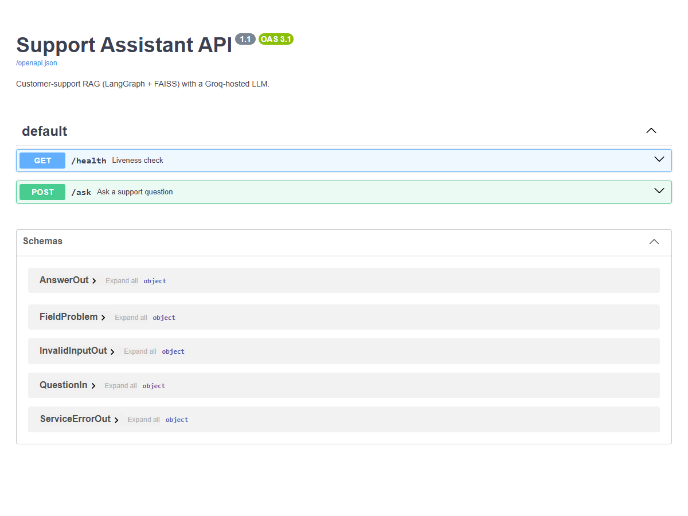
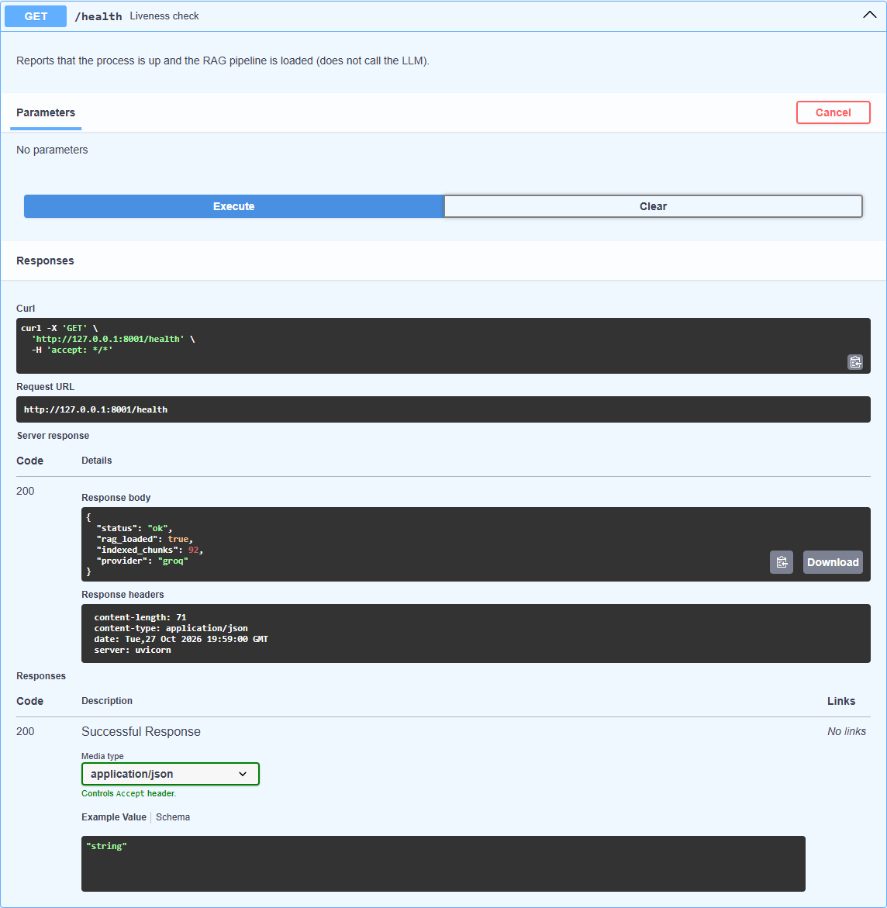
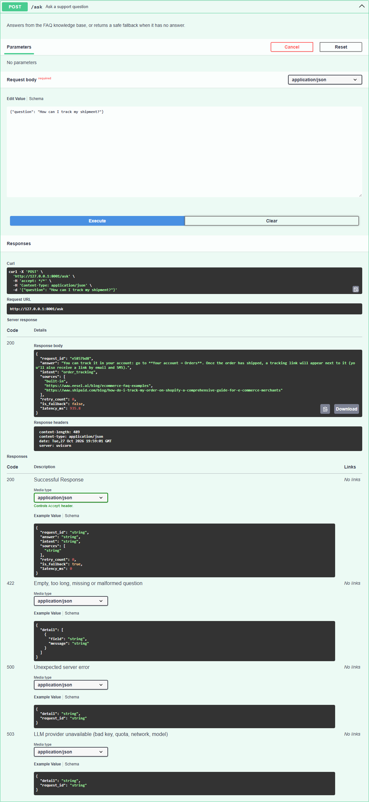
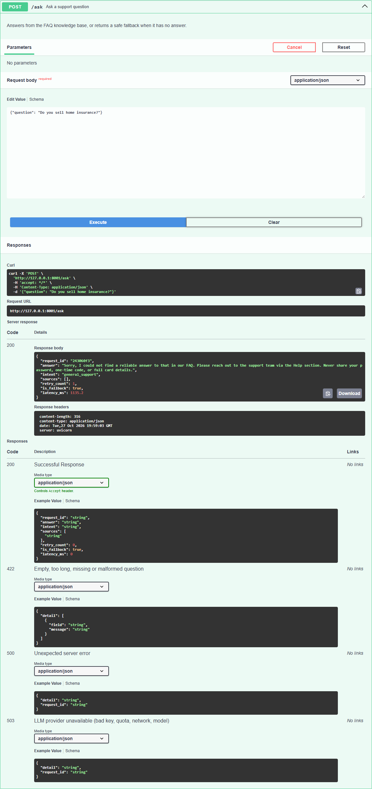
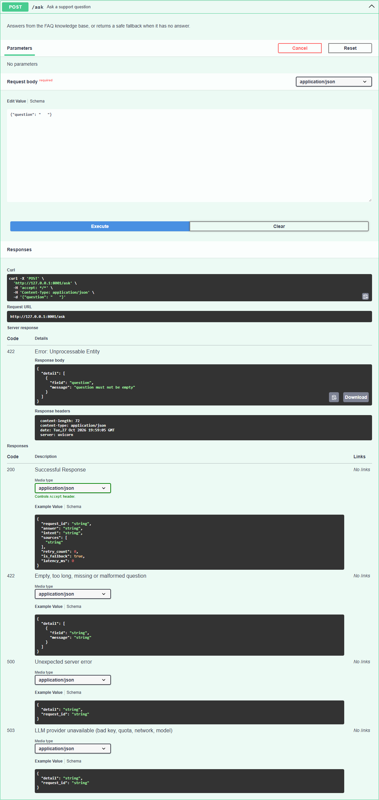
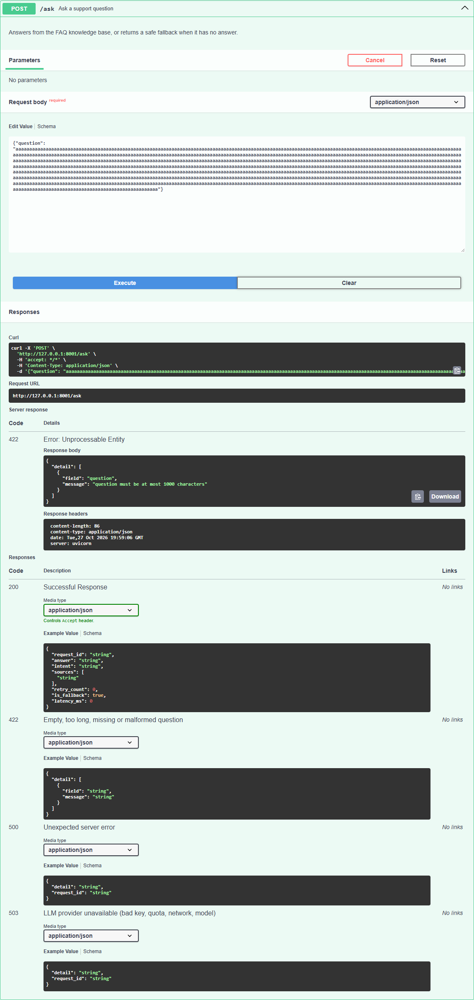
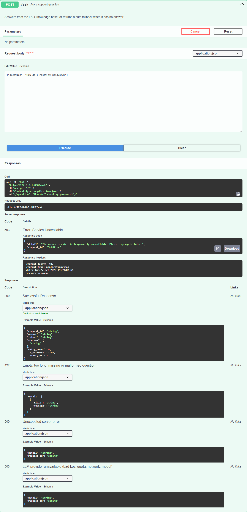
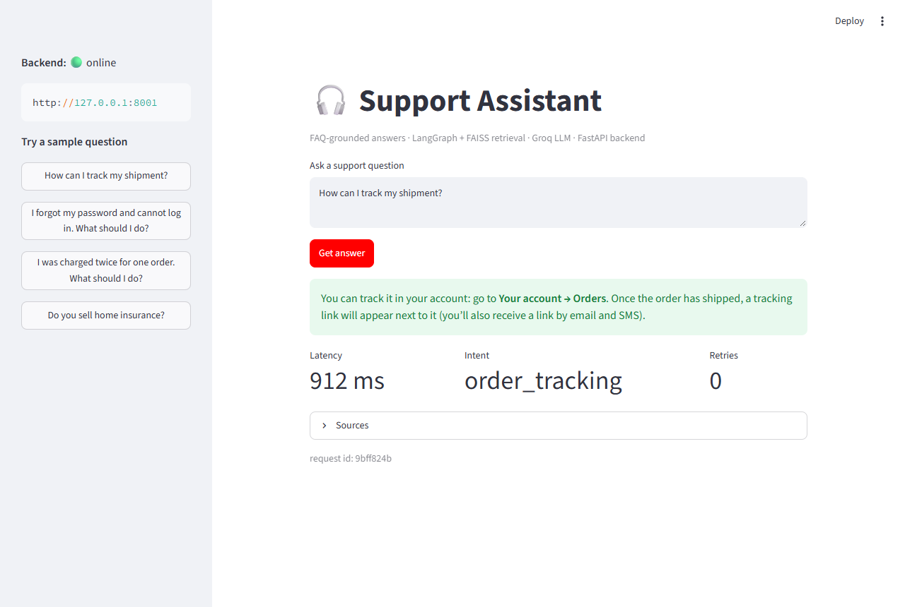
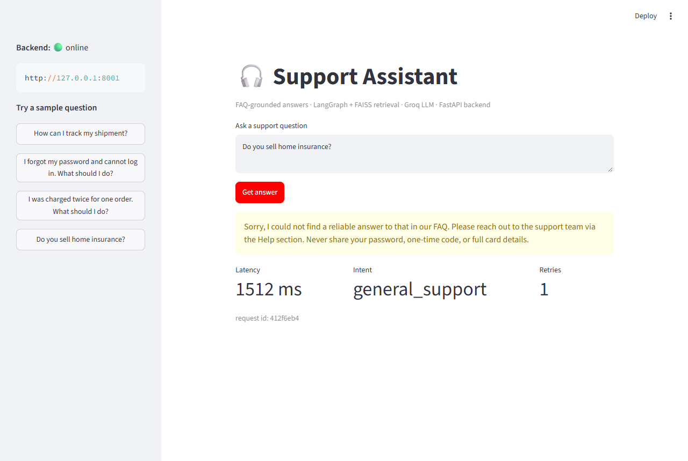

# Experiment 7 — Production-Ready Deployment of an LLM Application

This project takes the **Customer Support RAG assistant** built in Experiment 6 (LangChain + LangGraph + FAISS)
and wraps it as a **FastAPI** web service with a **Streamlit** frontend, adding the pieces a real deployment needs:
input validation, safe error handling, structured logging, latency measurement and secret management.

| Item | Choice |
|---|---|
| LLM backend | ☑ Cloud-hosted API — **Groq**, model `openai/gpt-oss-20b` &nbsp; ☐ Ollama (local) |
| Embeddings | `sentence-transformers/all-MiniLM-L6-v2` (runs locally on CPU) |
| Vector store | FAISS (in-memory) |
| Workflow | LangGraph state machine with one retry + safe fallback |
| API / UI | FastAPI + Uvicorn / Streamlit |

---

## 1. Architecture

```
            ┌──────────────┐  HTTP   ┌──────────────────────── FastAPI (app.py) ───────────────────────┐
  Browser → │ Streamlit UI │ ──────► │  POST /ask  → validate → SupportAssistant.answer() → JSON + ms  │
            └──────────────┘         │  GET /health                                                     │
                                     └───────────────────────────────┬──────────────────────────────────┘
                                                                     │  (built once at startup)
                         LangGraph workflow (rag_pipeline.py)        ▼
   detect_intent → fetch_context (FAISS top-3) → write_draft (LLM) → check_draft ──► done
                         ▲                                              │
                         └──── broaden_query  ◄── retry (max 1) ────────┤
                                                                        └──► use_fallback (fixed safe reply)
```

* Retrieval and generation are decoupled: `rag_pipeline.run_llm()` dispatches to `call_groq` or `call_mock`
  (chosen by `LLM_PROVIDER`), so the model can be swapped without touching retrieval.
* The embedding model, FAISS index and compiled graph are created **once** in the FastAPI `lifespan` hook and
  reused for every request.

## 2. Knowledge base

`knowledge_base.txt` holds public help-center pages (order tracking, returns, account access, billing) plus a
built-in **Store Help Center FAQ** covering: Order Tracking, Order Cancellation, Shipping Times and Costs,
Returns and Refunds, Account Access, Billing and Payments, Technical Support and Contact Support.
It is split into 450-character chunks (60 overlap) → **92 chunks** in FAISS.

## 3. Project structure

```
app.py                   FastAPI service: /ask, /health, validation, error handling, logging, latency
rag_pipeline.py          KB loading, chunking, embeddings, FAISS, LangGraph workflow, Groq/mock providers
streamlit_app.py         Streamlit frontend that calls the API
fetch_knowledge_base.py  Re-downloads the public help-center pages into knowledge_base.txt
knowledge_base.txt       Knowledge base (scraped help pages + built-in Store Help Center FAQ)
test_api.py              Offline pytest suite (mock provider, no API key needed)
.env.example             Config template — copy to .env (which is git-ignored)
screenshots/             Evidence for the observation table
```

## 4. Setup and run

```bash
python -m venv .venv
# Windows: .venv\Scripts\activate      Linux/macOS: source .venv/bin/activate
pip install -r requirements.txt

cp .env.example .env              # then paste your Groq key into .env
uvicorn app:app --port 8001       # Swagger UI: http://127.0.0.1:8001/docs
streamlit run streamlit_app.py    # UI: http://localhost:8501  (API_URL defaults to http://127.0.0.1:8001)

pytest -q                         # offline tests, no key required
```

Environment variables:

| Variable | Default | Purpose |
|---|---|---|
| `GROQ_API_KEY` | — | Groq API key (only in `.env`, never in code) |
| `GROQ_MODEL` | `openai/gpt-oss-20b` | Model name |
| `LLM_PROVIDER` | `groq` | `groq` or `mock` (offline) |
| `LLM_TIMEOUT` | `30` | Seconds before the provider call is aborted |
| `API_URL` | `http://127.0.0.1:8001` | Where the Streamlit UI finds the API |

## 5. API

**`GET /health`**
```json
{"status": "ok", "rag_loaded": true, "indexed_chunks": 92, "provider": "groq"}
```

**`POST /ask`** — body `{"question": "How can I track my shipment?"}`
```json
{
  "request_id": "82244674",
  "answer": "Check the **Orders** section of your account. After your order ships, a tracking link will appear there (and you'll also receive it by email and SMS).",
  "intent": "order_tracking",
  "sources": [
    "built-in",
    "https://www.eesel.ai/blog/ecommerce-faq-examples",
    "https://www.shipaid.com/blog/how-do-i-track-my-order-on-shopify-a-comprehensive-guide-for-e-commerce-merchants"
  ],
  "retry_count": 0,
  "is_fallback": false,
  "latency_ms": 746.3
}
```

| Status | When | Body |
|---|---|---|
| `200` | answered (or safe fallback) | see above |
| `422` | empty / whitespace / > 1000 chars / missing / wrong type | `{"detail": [{"field": "question", "message": "..."}]}` |
| `503` | LLM provider failed (bad key, quota, network, retired model) | generic message + `request_id` |
| `500` | unexpected server error | generic message + `request_id` |

## 6. Production-oriented features

- **Input validation** — question is stripped; empty or > 1000 characters is rejected with `422`. The submitted text
  is never echoed back in the error.
- **Error handling** — provider/network failures become a generic `503`; anything else a generic `500`. No stack
  trace, API key or provider response body ever reaches the client — only a `request_id` to match the server log.
- **Logging** — one line per request:
  `req=<id> status=success|failure intent=… fallback=… question_chars=… latency_ms=…`.
  The question text and the API key are never logged.
- **Latency** — measured with `time.perf_counter()`, returned as `latency_ms` and written to the log.
- **Secrets** — key lives in `.env` (git-ignored); only the placeholder `.env.example` is committed.
- **Hallucination guard** — the prompt tells the LLM to answer only from the FAQ context and otherwise output
  `INSUFFICIENT_CONTEXT`; the graph then retries once with a broadened query and, if still unanswered, returns a
  fixed safe reply (`is_fallback: true`) instead of inventing a policy.
- **Load once** — heavy objects are built at startup, not per request (startup ≈ 10–45 s vs. ~1 s per request).

Sample server log (this run):
```
01:28:56,875 INFO api startup finished in 11614 ms (provider=groq)
01:29:02,885 INFO api req=e5857bd8 status=success intent=order_tracking fallback=False question_chars=28 latency_ms=936
01:29:05,444 INFO api req=243060f3 status=success intent=general_support fallback=True question_chars=27 latency_ms=1135
01:29:06,649 WARNING api rejected request: invalid input (1 problem(s))
01:29:07,662 WARNING api rejected request: invalid input (1 problem(s))
01:29:09,024 ERROR api req=5e63f1ec status=failure reason=provider returned HTTP 401 latency_ms=318
```

## 7. Screenshots

| | |
|---|---|
| **Swagger UI**  | **GET /health**  |
| **Supported question → grounded answer**  | **Unsupported question → fallback**  |
| **Empty question → 422**  | **Too-long question → 422**  |
| **Invalid API key → 503**  | |
| **Streamlit — supported**  | **Streamlit — unsupported**  |

## 8. Observation table

| # | Test case | Expected result | Actual result | Pass/Fail |
|---|---|---|---|---|
| 1 | Health endpoint | API reports it is running | `200 {"status":"ok","rag_loaded":true,"indexed_chunks":92,"provider":"groq"}` | Pass |
| 2 | Supported question — "How can I track my shipment?" | Grounded answer | Answer taken from the Orders-section / tracking-link passages, 3 sources, `retry_count: 0`, ~0.7–2.5 s | Pass |
| 3 | Supported question — "I was charged twice for one order…" | Grounded answer | Billing answer (check statement, pending holds, contact billing with transaction date), intent `billing_payments` | Pass |
| 4 | New FAQ topic — "Can I cancel my order?" | Grounded answer | Cancel from Orders before dispatch, otherwise return after delivery; intent `order_cancellation` | Pass |
| 5 | Unsupported question — "Do you sell home insurance?" | Not-enough-information / fallback | 1 retry with broadened query, then fixed safe reply, `is_fallback: true`, no sources cited | Pass |
| 6 | Empty / whitespace question | Validation error | `422 {"field":"question","message":"question must not be empty"}` | Pass |
| 7 | Question > 1000 characters | Validation error | `422 "question must be at most 1000 characters"` (input not echoed) | Pass |
| 8 | Missing field / non-string / malformed JSON | Validation error | `422` — `Field required` / `Input should be a valid string` / `JSON decode error` | Pass |
| 9 | Backend unavailable (invalid API key) | Controlled error, no secret details | `503` generic message + `request_id`; server log shows only `provider returned HTTP 401` | Pass |
| 10 | Response-time measurement | Latency recorded | `latency_ms` in every response and in the log line | Pass |
| 11 | Streamlit UI | Shows answer, latency, intent, retries | Green box for answers, yellow for fallback, metrics + sources + request id | Pass |

> **Model note:** Groq's older default `llama-3.1-8b-instant` was retired (HTTP 404), so the available models were
> listed via the `/models` endpoint and `openai/gpt-oss-20b` was chosen. A wrong or retired model name surfaces as a
> controlled `503`, exactly like an invalid key.

Automated tests (`pytest -q`, mock provider):
```
..........                                                               [100%]
10 passed in 47.10s
```

## 9. Viva questions

1. **Purpose of FastAPI?** It exposes the RAG pipeline over HTTP so any client (web UI, mobile app, another service)
   can send a question and get a JSON answer. It also gives automatic request validation and interactive docs.
2. **Local vs cloud LLM?** A local LLM (e.g. Ollama) runs on your own hardware and uses its RAM/GPU; a cloud API runs
   on the provider's servers and is reached over the internet, which brings API keys, quotas, cost and network dependence.
3. **Does hosting FastAPI in the cloud mean the LLM is hosted there too?** No. The API layer and the model are
   separate; the API can call a provider such as Groq or a separately hosted model server.
4. **Why not hard-code the API key?** Code is committed and shared, so the key would leak. Environment variables /
   `.env` keep it out of version control and let each environment use (and rotate) its own key.
5. **What is input validation and why a max length?** Checking input is well-formed before processing it. A length
   cap blocks abuse, keeps token cost and latency bounded, and avoids oversized prompts.
6. **What does the health endpoint show, and its limitation?** That the process is up and the pipeline is loaded, for
   monitors/load balancers. It does not prove the LLM provider, key, quota or network actually work.
7. **Why not reload the model/index per request?** Loading is slow and memory-heavy (seconds vs. ~1 s per request);
   load once at startup and reuse.
8. **What if the answer is not in the knowledge base?** Say there isn't enough information and direct the user to
   support instead of hallucinating — implemented here by the `INSUFFICIENT_CONTEXT` → retry → fallback path.
9. **Two reasons a cloud LLM call can fail?** Invalid/expired key or exhausted quota/rate limit (401/429); network
   outage/timeout or a wrong/retired model name (404).
10. **Is this fully production-ready?** No. Still missing: authentication, HTTPS, rate limiting, monitoring/alerting,
    a proper secret manager, load testing, answer-quality evaluation and a recovery plan.

## 10. Limitations

- Intent detection is keyword-based.
- `check_draft` only looks for the `INSUFFICIENT_CONTEXT` marker; it is not a factuality checker.
- The knowledge base is public third-party help pages used as sample FAQ content.
- Do not send confidential or personal data to a third-party LLM API.
